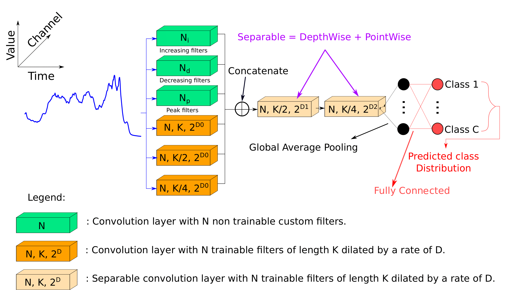
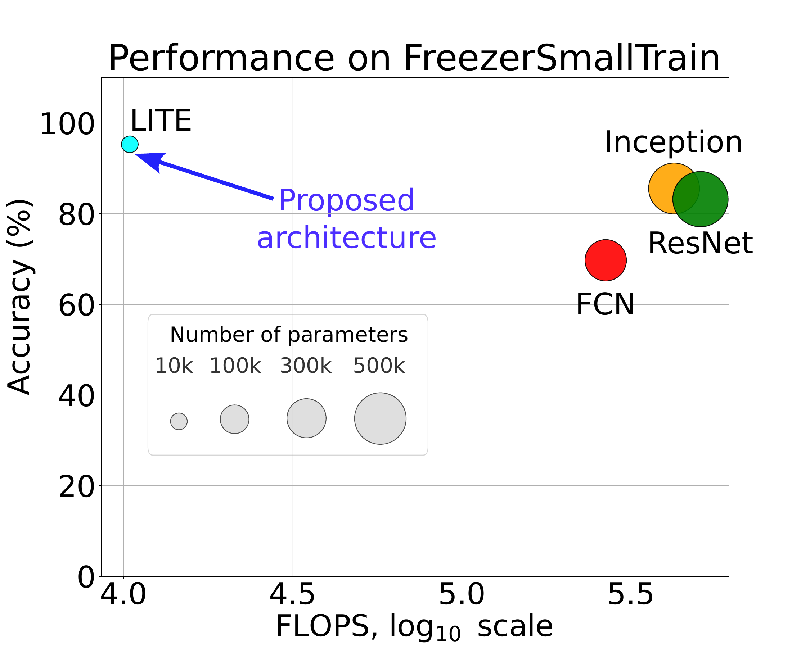
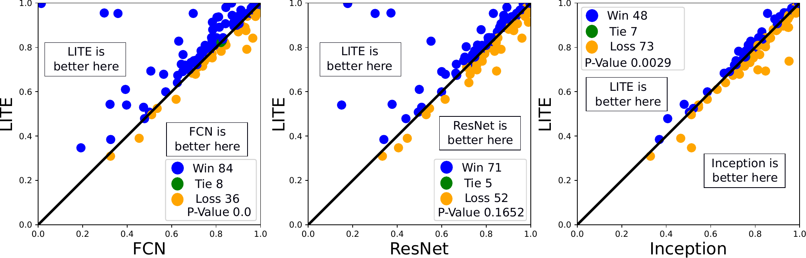
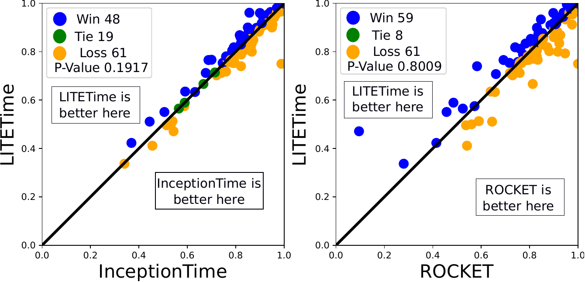
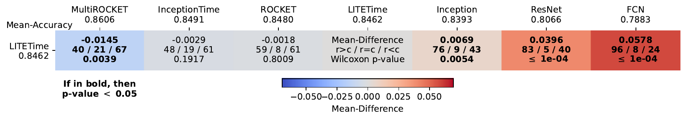
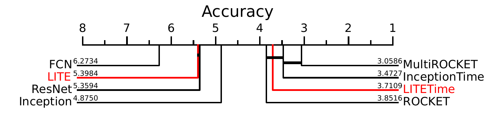

> ⚠️ **Alert:** If you are using this code with **Keras v3**, make sure you are using **Keras ≥ 3.6.0**.  
> Earlier versions of Keras v3 do not honor `trainable=False`, which will result in **training hand-crafted filters** in **LITE** and **LITEMV** unexpectedly.


# LITE: Light Inception with boosTing tEchniques for Time Series Classification

This is the source code of our paper "[LITE: Light Inception with boosTing tEchniques for Time Series Classification](https://germain-forestier.info/publis/dsaa2023.pdf)" accepted at the 10th IEEE International Conference on Data Science and Advanced Analytics ([DSAA 2023](https://conferences.sigappfr.org/dsaa2023/)) in the  Learning from Temporal Data ([LearnTeD](https://dsaa2023.inesctec.pt/)) special session track. <br>
This is the source code for the extended version of the DSAA 2023 paper, "[Look into the LITE in deep learning for time series classification](https://link.springer.com/article/10.1007/s41060-024-00708-5)" published in the [International Journal of Data Science and Analytics](https://link.springer.com/journal/41060) in their special issue on [Learning from Temporal Data](https://link.springer.com/collections/dibidcifjj).
This work was done by [Ali Ismail-Fawaz](https://hadifawaz1999.github.io/), [Maxime Devanne](https://maxime-devanne.com/), [Stefano Berretti](www.micc.unifi.it/berretti/), [Jonathan Weber](https://www.jonathan-weber.eu/) and [Germain Forestier](https://germain-forestier.info/).


## Project Overview

This repository contains the original LITE implementation and an additional experimental investigation into techniques for improving LITE time-series classification. The experiments compare modifications against the original LITE and LITETime baselines across six UCR datasets.

The aim is to understand which techniques help, under what dataset conditions they help, and where they fail. The experimental work is an extension of the published LITE implementation; it does not claim authorship of the original LITE architecture.

## Experimental Contributions

The investigation evaluates four main areas:

1. **Data augmentation:** amplitude scaling, Gaussian noise and circular time shifts, tested individually and in combination.
2. **Input transformations:** first-difference features added as an additional input channel.
3. **Ensemble learning:** averaging softmax probabilities from multiple LITE models, following the LITETime approach.
4. **Batch normalisation recalibration:** recomputing batch-normalisation statistics after training using training data, without retraining or using test data.

Validation-based training and validation-based epoch selection with full-training-set refitting were also investigated.

## Key Findings

The results are dataset-dependent; no single modification consistently improves performance across all six datasets. Selected findings include:

| Dataset | Experimental result | Paper LITETime baseline |
|---|---:|---:|
| Wine | 87.0% (scale-only ensemble) | 66.7% |
| PigAirwayPressure | 60.6% (scale-only ensemble) | 47.1% |
| SemgHandMovementCh2 | 54.2% (recalibrated 4-model ensemble) | 51.1% |
| OliveOil | 83.3% (plain LITE or recalibration) | 80.0% |
| ShapeletSim | 76.1% (scale-only ensemble) | 75.0% |
| Beef | 76.7% (plain LITE or first-difference ensemble) | 76.7% |

These are the best observed results per dataset, selected after evaluating the methods, and should not be interpreted as evidence that one fixed method generalises across all datasets. The experiments use limited numbers of seeds and some datasets have small test sets. See the full report for the detailed comparisons and caveats.

**Detailed experimental report:** [experiment_results/FINAL_RESULTS.md](experiment_results/FINAL_RESULTS.md).

## Repository Structure

| Path | Description |
|---|---|
| `src/` | LITE model and supporting implementation |
| `main.py` | Original LITE training and evaluation entry point |
| `run_ablation.py` | Runs controlled training ablation experiments |
| `ensemble_eval.py` | Evaluates ensembles of saved LITE checkpoints |
| `recalibrate_eval.py` | Evaluates batch-normalisation recalibration |
| `experiment_results/` | Experimental summaries and per-run result files |
| `LITE_*_kaggle.ipynb` | Experiment-specific Kaggle notebooks |
| `results.csv` and other result CSVs | Original benchmark and experimental result tables |

## The LITE architecture

The same LITE architecture is then used to form an ensemble of five LITE models, names LITETime.
<p align="center" width="50%">

</p>

## Usage of the code

To use this code, running the ```main.py``` file with the following options in the parsed as arguments:

```
--dataset : to choose the dataset from the UCR Archive (default=Coffee)
--classifier : to choose the classifier, in this case only LITE can be chosen (default=LITE)
--runs : to choose the number of runs (default=5)
--output-directory : to choose the output directory name (default=results/)
--track-emissions : to choose wether or not to track the training/testing time and CO2/power consumotion.
```

### Adaptation of code

The only change to be done in the code is the ```folder_path``` in the `utils/utils.py` file, this line. This directory should point to the parent directory of the UCR Archive datasets.

### Using [aeon-toolkit](https://github.com/aeon-toolkit/aeon) to Train a LITETimeClassifier on your DATA

When using aeon, simply load your data and create an instance of a LITETime classifier and train it, as well as LITEMVTime classifier for multivariate time series <br>

```
from aeon.datasets import load_classification
from aeon.classification.deep_learning import LITETimeClassifier

xtrain, ytrain, _ = load_classification(name="Coffee", split="train")
xtest, ytest, _ = load_classification(name="Coffee", split="test")

# using LITETime
clf = LITETimeClassifier(n_classifiers=5)
clf.fit(xtrain, ytrain)
print(clf.score(xtest, ytest)

# using LITEMVTime for multivariate
clf = LITETimeClassifier(n_classifiers=5, use_litemv=True)
clf.fit(xtrain, ytrain)
print(clf.score(xtest, ytest)
```

## Results

Results can be found in the [results.csv](https://github.com/MSD-IRIMAS/LITE/blob/main/results.csv) file for [FCN](https://github.com/hfawaz/dl-4-tsc/blob/master/classifiers/fcn.py), [ResNet](https://github.com/hfawaz/dl-4-tsc/blob/master/classifiers/resnet.py), [Inception](https://github.com/hfawaz/InceptionTime), [InceptionTime](https://github.com/hfawaz/InceptionTime), [ROCKET](https://github.com/angus924/rocket), [MultiROCKET](https://github.com/ChangWeiTan/MultiRocket), LITE and LITETime. For non-ensemble methods, results are averaged over five runs, for ensemble methods, we ensemble the five runs.

### Average performance and FLOPS comparison

The following figure shows the comparison between LITE and state of the art complex deep learners. The comparison consists on the average performance and the number FLOPS.
<p align="center" width="100%">

</p>

### LITE 1v1 with FCN, ResNet and Inception

The following compares LITE with FCN, ResNet and Inception using the accuracy performance on the test set of the 128 datasts of the UCR archive.

<p align="center" width="100%">

</p>

### LITETime 1v1 with ROCKET and InceptionTime

The following compares LITE with FCN, ResNet and Inception using the accuracy performance on the test set of the 128 datasts of the UCR archive.

<p align="center" width="50%">

</p>

### LITETime MCM with SOTA

The following 1v1 and multi-comparison matrix shows the performance of LITETime with respect to the SOTA models for Time Series Classification.

The following compares LITE with FCN, ResNet and Inception using the accuracy performance on the test set of the 128 datasts of the UCR archive.

<p align="center" width="100%">

</p>

### CD Diagram

The following Critical Difference Diagram (CDD) shows the comparison following the average rank between classifiers.

<p align="center" width="100%">

</p>


## Experimental Setup and Reproducibility

The experimental scripts use Python with TensorFlow/Keras, NumPy, scikit-learn and aeon. Experiments were run across local GPU and Kaggle GPU environments. The detailed report records the datasets, training configurations, seeds, comparisons and observed limitations.

The original LITE entry point and the additional experimental scripts serve different purposes: the usage instructions above describe the original `main.py` workflow, while `run_ablation.py`, `ensemble_eval.py` and `recalibrate_eval.py` support the experimental investigation described in the report.

**Checkpoint availability:** Model checkpoints (`.keras`) are not included in this repository. Checkpoint-dependent evaluations, including batch-normalisation recalibration, require the corresponding saved model files from the local results folders or Kaggle output archives. The committed scripts, notebooks, result files and report document the experiments, but the absence of checkpoints means those evaluations cannot be reproduced from this repository alone.

## Requirements

```
numpy
pandas
scikit-learn
tensorflow>=2.16.1
keras>=3.6.0
matplotlib
codecarbon
```

## Citation

```
@article{ismail2025look,
  title={Look into the lite in deep learning for time series classification},
  author={Ismail-Fawaz, Ali and Devanne, Maxime and Berretti, Stefano and Weber, Jonathan and Forestier, Germain},
  journal={International Journal of Data Science and Analytics},
  pages={1--21},
  year={2025},
  publisher={Springer}
}
@inproceedings{Ismail-Fawaz2023LITELightInception,
  author = {Ismail-Fawaz, A. and Devanne, M. and Berretti, S. and Weber, J. and Forestier, G.},
  title = {LITE: Light Inception with boosTing tEchniques for Time Series Classification},
  booktitle = {International Conference on Data Science and Advanced Analytics (DSAA)},
  year = {2023}
}
```


## Acknowledgments

This work was supported by the ANR DELEGATION project (grant ANR-21-CE23-0014) of the French Agence Nationale de la Recherche. The authors would like to acknowledge the High Performance Computing Center of the University of Strasbourg for supporting this work by providing scientific support and access to computing resources. Part of the computing resources were funded by the Equipex Equip@Meso project (Programme Investissements d’Avenir) and the CPER Alsacalcul/Big Data. The authors would also like to thank the creators and providers of the UCR Archive.


