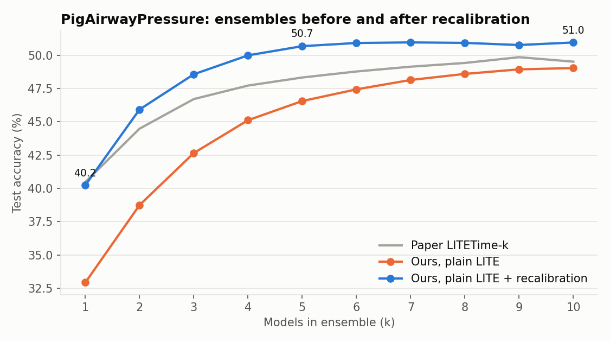

# Improving LITE: Methods Tried and Results

As of 2026-11-13.

## Summary

Two changes beat the LITE paper on some datasets: scale-only augmentation (Wine 87.0% vs 66.7%, PigAirwayPressure 60.6% vs 47.1%) and batch-norm recalibration after training (SemgHandMovementCh2, PigAirwayPressure, Wine, OliveOil). No single method helped on every dataset, and Beef only tied the paper (76.7%).

Validation-based training, first-difference input and the full augmentation did not improve on plain LITE. All accuracies below are test accuracy in percent; ensembles average the softmax outputs of 5 models, as LITETime does.

## Setup

Six UCR datasets were used, loaded with aeon and z-normalised per series as in the LITE code. Paper numbers come from the repo's `results.csv` and `results_ensemble_study.csv`.

| Dataset | Train / test series | Classes | Length | Paper LITE (%) | Paper LITETime (%) |
| --- | --- | --- | --- | --- | --- |
| SemgHandMovementCh2 | 450 / 450 | 6 | 1500 | 47.9 | 51.1 |
| PigAirwayPressure | 104 / 208 | 52 | 2000 | 34.7 | 47.1 |
| Beef | 30 / 30 | 5 | 470 | 72.0 | 76.7 |
| Wine | 57 / 54 | 2 | 234 | 64.1 | 66.7 |
| OliveOil | 30 / 30 | 4 | 570 | 69.3 | 80.0 |
| ShapeletSim | 20 / 180 | 2 | 500 | 73.8 | 75.0 |

- **Training:** LITE as in the paper: 1500 epochs, Adam, learning rate halved after 50 epochs without improvement (minimum 1e-4), best checkpoint by training loss.
- **Ensembles:** softmax outputs of models trained with different seeds are averaged, the same way LITETime combines 5 LITE models.
- **Comparisons:** each method is compared with plain LITE on the same seeds and the same machine (laptop GTX 1650 under WSL, or Kaggle T4). The same seed does not give identical results on different machines.

## Methods tried

Ten changes to LITE were tested; the first four change how training is controlled or what the model sees, the rest add augmentation or fix the model after training.

1. **Validation-based training:** hold out a stratified 20% of the training set and stop early on validation loss (patience 100).
2. **Validation + refit:** choose the number of epochs on the validation split, then retrain on the full training set for that many epochs.
3. **First difference:** add the series' step-to-step change (its derivative) as a second input channel.
4. **Validation + first difference:** methods 1 and 3 together.
5. **Full augmentation (training only):** random amplitude scaling (sd 0.1), Gaussian noise (sd 0.03) and a circular time shift of up to 10% of the length.
6. **Single augmentation components:** scale only, noise (jitter) only, shift only, each at the same strength as in method 5.
7. **Weaker scale:** scale-only augmentation with sd 0.05.
8. **Mixed ensembles:** plain and scale-only models averaged together.
9. **Batch-norm recalibration:** after training, recompute the batch-norm statistics from one pass over the full training set. No retraining and no test data are used.
10. **Scale-only + recalibration:** method 9 applied to scale-only models.

## Results per method

### Validation and first difference (methods 1–4)

None of these beat plain LITE. Mean single-model accuracy, 1500 epochs, seeds 0–4.

| Method | SemgHandMovementCh2 (%) | PigAirwayPressure (%) |
| --- | --- | --- |
| Plain LITE | 46.6 | 26.3 |
| Validation | 46.4 | not possible (2 train series per class) |
| Validation + first difference | 42.8 | not possible |
| First difference | 42.5 | 23.9 |
| Validation + refit | 38.3 | not possible |

Validation-trained ensembles also tracked plain ones on SemgHand (4 models: 51.3% vs 52.0%). First difference was later tried on Beef and ShapeletSim (table further down).

### Augmentation components (methods 5–6)

The full augmentation hurt both datasets; scale caused the drop on SemgHand and noise caused it on Pig. Mean single-model accuracy on Kaggle, SemgHand seeds 0–2, Pig seeds 0–4.

| Augmentation | SemgHandMovementCh2 (%) | PigAirwayPressure (%) |
| --- | --- | --- |
| None (plain LITE) | 45.1 | 26.3 |
| Full (scale + noise + shift) | 41.0 | 9.6 |
| Shift only | 45.1 | 27.3 |
| Scale only | 42.3 | **33.8** |
| Noise only | 46.1 | 13.6 |

### Scale-only augmentation (methods 6–8)

Scale only helped Wine, Pig and, slightly, ShapeletSim; it hurt Beef, OliveOil and SemgHand, and a weaker scale did not change that. 5-model ensembles.

| Dataset | Plain LITE (%) | Scale sd 0.1 (%) | Scale sd 0.05 (%) | Paper LITETime (%) |
| --- | --- | --- | --- | --- |
| Wine | 55.6 | **87.0** | — | 66.7 |
| PigAirwayPressure (seeds 5–9) | 53.4 | **60.6** | — | 47.1 |
| ShapeletSim | 73.9 | **76.1** | 75.6 | 75.0 |
| Beef | **76.7** | 70.0 | 70.0 | 76.7 |
| OliveOil | **83.3** | 76.7 | 73.3 | 80.0 |
| SemgHandMovementCh2 | — | — | 50.0 | 51.1 |

- On Pig, scale only won 8 of 10 seeds as single models (38.3% vs 33.5%, paired t-test p = 0.10). None of the 3003 possible 5-model ensembles of 15 plain Pig models reached 60.6% (best 54.3%).
- SemgHand single models: plain 46.8%, scale sd 0.1 42.3% (3 seeds), scale sd 0.05 43.7%.
- Mixed ensembles (plain + scale models together) always landed between the two, e.g. Wine 75.9%, Pig 57.7%.

### First difference on Beef and ShapeletSim (method 3)

First difference improved Beef single models, which are spectra, and hurt ShapeletSim on all 5 seeds.

| Dataset | Plain single (%) | First-diff single (%) | Plain ensemble (%) | First-diff ensemble (%) |
| --- | --- | --- | --- | --- |
| Beef (laptop) | 72.0 | **74.7** | 76.7 | 76.7 |
| ShapeletSim (Kaggle) | **71.4** | 68.2 | **77.2** | 73.9 |

### Batch-norm recalibration (methods 9–10)

Recalibration improved 4 of 6 datasets without retraining. It mainly repairs models that fit the training set in training mode but fail in prediction mode; plain Wine models scored only 56–63% on their own training data before recalibration.

| Dataset | Single, before → after (%) | Ensemble, before → after (%) | Paper LITETime (%) |
| --- | --- | --- | --- |
| Wine | 63.0 → **78.5** | 55.6 → **83.3** | 66.7 |
| PigAirwayPressure (10 seeds) | 32.9 → **40.2** | 46.6 → **50.7** (5 models), 49.0 → **51.0** (10 models) | 47.1 (LITETime-10: 49.5) |
| SemgHandMovementCh2 (4 seeds) | 46.8 → **49.5** | 52.0 → **54.2** (4 models) | 51.1 |
| OliveOil | 79.3 → **82.7** | 83.3 → 83.3 | 80.0 |
| ShapeletSim | 72.7 → 72.2 | 73.9 → 73.9 | 75.0 |
| Beef | 72.0 → 70.7 | 76.7 → 73.3 | 76.7 |

Recalibrating scale-only models raised single models (Pig 42.9% → 51.8%, Wine 70.4% → 80.4%) but not ensembles (Pig 60.6% → 60.1%, Wine 87.0% → 79.6%). The two fixes overlap rather than add up.

## Best result per dataset

Five of six datasets beat the paper's LITETime with at least one method; Beef tied. The best method differs by dataset.

| Dataset | Best method | Ours (%) | Paper LITETime (%) | Gap in test series |
| --- | --- | --- | --- | --- |
| PigAirwayPressure | Scale only | 60.6 | 47.1 | +28 of 208 |
| Wine | Scale only | 87.0 | 66.7 | +11 of 54 |
| SemgHandMovementCh2 | Recalibration (4 models) | 54.2 | 51.1 | +14 of 450 |
| ShapeletSim | Scale only | 76.1 | 75.0 | +2 of 180 |
| OliveOil | Plain LITE or recalibration | 83.3 | 80.0 | +1 of 30 |
| Beef | Plain LITE or first difference | 76.7 | 76.7 | 0 of 30 |

If one method has to be fixed in advance for every dataset, recalibration is the safest: it never lost more than about one test series and needs no retraining.

## Caveats

The largest gains (Pig, Wine, SemgHand) are well beyond seed noise; the small ones (ShapeletSim, OliveOil, Beef) are not.

- **Small test sets:** on Beef and OliveOil one test series is 3.3 points, on Wine 1.9 points.
- **Few seeds:** 3 to 10 per comparison. The Pig single-model gain from scale only has p = 0.10 over 10 seeds.
- **Method picked per dataset after seeing test results:** the best-per-dataset table is optimistic. A fair claim fixes one method for all datasets in advance.
- **Machine-to-machine variation:** the same plain LITE ensemble on ShapeletSim scored 73.9% on the laptop and 77.2% on Kaggle.
- **One scale-only Pig ensemble:** only seeds 5–9 kept their checkpoints, so 60.6% comes from a single 5-model set.
- **Recalibration is a known technique** (sometimes called "precise BN"). The project's contribution is applying it to LITE and showing that LITE's failures on Wine and Pig come from the training/prediction mismatch in batch norm.
- **Pig seeds 2 and 3 fail under every method** (3–22%); recalibration recovers them only partly.

## Code and raw results

| What | Where |
| --- | --- |
| Training script (all conditions, augmentation flags) | `run_ablation.py` |
| Ensemble evaluation of saved checkpoints | `ensemble_eval.py` |
| Batch-norm recalibration and mixed ensembles | `recalibrate_eval.py` |
| Final results notebook (loads saved models, computes all metrics and figures) | `LITE_final_results.ipynb` → `experiment_results/figures/`, `final_results_computed.csv` |
| Reproduction notebook (plain LITE on Wine and OliveOil, Kaggle) | `LITE_reproduction_kaggle.ipynb` |
| Saved models used by the final notebook | `final_models/<dataset>/<method>/seed_N.keras` |
| Kaggle notebooks | `LITE_*_kaggle.ipynb` (augment, augment components, augconfirm, ensemble, ensemble Beef/Pig, SemgHand scale 0.05, ShapeletSim first difference) |
| Per-run results (CSV) | `experiment_results/` — one folder per experiment, e.g. `scale_only_laptop/`, `augconfirm_pig_kaggle/`, `shapelet_first_difference_kaggle/` |

Model checkpoints (`.keras`) are not in the repo; they stay in the local `results_ablation/` folders and the Kaggle output zips. `recalibrate_eval.py` needs them.
