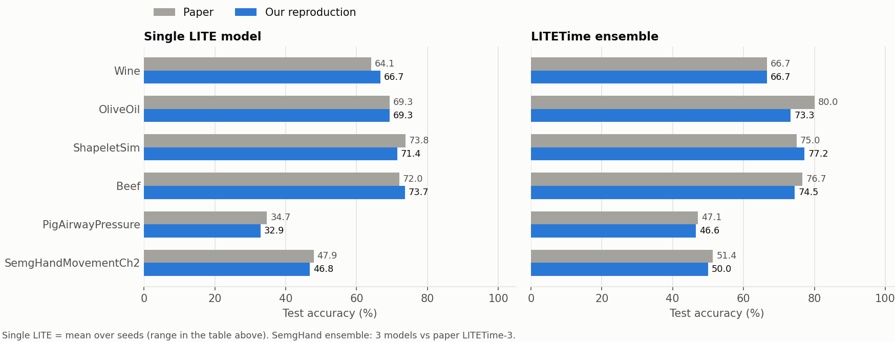
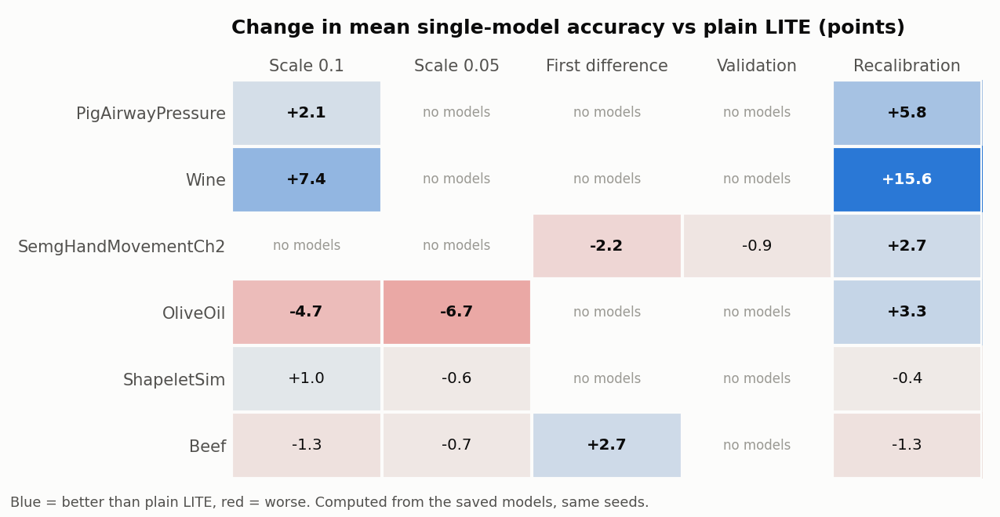
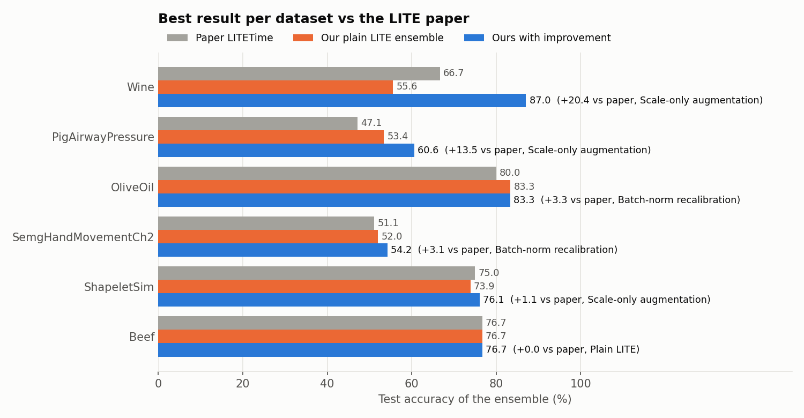

# Improving LITE: Methods Tried and Results

Updated 2026-11-16.

## Summary

The results are dataset-dependent. Scale-only augmentation produced the strongest observed ensemble scores on Wine (87.0% vs 66.7% for published LITETime) and PigAirwayPressure (60.6% vs 47.1%). Batch normalization recalibration improved selected results, including a four-model SemgHandMovementCh2 ensemble at 54.2%; its published comparison value of 51.1% is for a five-model LITETime ensemble, so that comparison is not size-matched. On SemgHandMovementCh2, validation-based early stopping preserved mean accuracy (46.4% vs 46.6% for plain LITE) while reducing mean training time (3.5 vs 20.2 minutes). No method helped every dataset, and Beef tied the paper reference (76.7%).

Validation-based training, first-difference input and full augmentation did not improve test accuracy over plain LITE in the comparisons reported below, although validation-based early stopping substantially reduced training time on SemgHandMovementCh2. Accuracies are test accuracy in percent. Most ensembles average five models, matching LITETime; where an experiment uses a different ensemble size, it is identified explicitly.

## Setup

Six UCR datasets were used, loaded with aeon and z-normalised per series as in the LITE code. Paper numbers come from the repository's `results.csv` and `results_ensemble_study.csv`. LITETime references are five-model results unless a model-count variant is named explicitly.

| Dataset | Train / test series | Classes | Length | Paper LITE (%) | Paper LITETime (%) |
| --- | --- | --- | --- | --- | --- |
| SemgHandMovementCh2 | 450 / 450 | 6 | 1500 | 47.9 | 51.1 |
| PigAirwayPressure | 104 / 208 | 52 | 2000 | 34.7 | 47.1 |
| Beef | 30 / 30 | 5 | 470 | 72.0 | 76.7 |
| Wine | 57 / 54 | 2 | 234 | 64.1 | 66.7 |
| OliveOil | 30 / 30 | 4 | 570 | 69.3 | 80.0 |
| ShapeletSim | 20 / 180 | 2 | 500 | 73.8 | 75.0 |

- **Training:** LITE as in the paper: 1500 epochs, Adam, learning rate halved after 50 epochs without improvement (minimum 1e-4), best checkpoint by training loss.
- **Ensembles:** softmax outputs of models trained with different seeds are averaged, the same way LITETime combines 5 LITE models.
- **Comparisons:** each method is compared with plain LITE on the same seeds and the same machine (laptop GTX 1650 under WSL, or Kaggle T4). The same seed does not give identical results on different machines.

## Reproduction of plain LITE

Our plain LITE runs (the paper's method, unchanged) land close to the paper on all six datasets. All Kaggle T4 runs; computed in `LITE_reproduction.ipynb`. Ensembles are 5 models (for Pig and Beef, the mean over every 5-model subset of 10 models); Kaggle kept only 3 SemgHand models, so SemgHand is compared with the paper's LITETime-3.

| Dataset | Ours, single mean (%) | Paper LITE (%) | Ours, ensemble (%) | Paper LITETime (%) | Seeds |
| --- | --- | --- | --- | --- | --- |
| Wine | 66.7 | 64.1 | 66.7 | 66.7 | 0–4 |
| OliveOil | 69.3 | 69.3 | 73.3 | 80.0 | 0–4 |
| ShapeletSim | 71.4 | 73.8 | 77.2 | 75.0 | 0–4 |
| Beef | 73.7 | 72.0 | 74.5 | 76.7 | 0–9 |
| PigAirwayPressure | 32.9 | 34.7 | 46.6 | 47.1 | 0–9 |
| SemgHandMovementCh2 | 46.8 | 47.9 | 50.0 (3 models) | 51.4 (LITETime-3) | 0–4 |

OliveOil's ensemble is 2 of 30 test series below the paper; seed 2 scored 50%. On Wine, plain LITE collapsed on 3 of 5 seeds on the laptop (ensemble 55.6%) but not on Kaggle (66.7%), so the laptop baseline in the tables below is unusually low for Wine.

## Methods tried

Ten changes to LITE were tested; the first four change how training is controlled or what the model sees, the rest add augmentation or fix the model after training.

1. **Validation-based training:** hold out a stratified 20% of the training set and stop early on validation loss (patience 100).
2. **Validation + refit:** choose the number of epochs on the validation split, then retrain on the full training set for that many epochs.
3. **First difference:** add the series' step-to-step change (its derivative) as a second input channel.
4. **Validation + first difference:** methods 1 and 3 together.
5. **Full augmentation (training only):** random amplitude scaling (sd 0.1), Gaussian noise (sd 0.03) and a circular time shift of up to 10% of the length.
6. **Single augmentation components:** scale only, noise (jitter) only, shift only, each at the same strength as in method 5.
7. **Weaker scale:** scale-only augmentation with sd 0.05.
8. **Mixed ensembles:** plain and scale-only models averaged together.
9. **Batch-norm recalibration:** after training, recompute the batch-norm statistics from one pass over the full training set. No retraining and no test data are used.
10. **Scale-only + recalibration:** method 9 applied to scale-only models.

## Results per method

### Validation and first difference (methods 1–4)

None of these methods improved mean test accuracy over plain LITE in this comparison. Validation-based early stopping reduced training time while preserving mean accuracy. Mean single-model accuracy, 1500 epochs, seeds 0–4.

| Method | SemgHandMovementCh2 (%) | PigAirwayPressure (%) |
| --- | --- | --- |
| Plain LITE | 46.6 | 26.3 |
| Validation | 46.4 | not possible (2 train series per class) |
| Validation + first difference | 42.8 | not possible |
| First difference | 42.5 | 23.9 |
| Validation + refit | 38.3 | not possible |

Validation-trained ensembles also tracked plain ones on SemgHand (4 models: 51.3% vs 52.0%). In the paired five-seed single-model comparison, validation reached 46.4% mean accuracy versus 46.6% for plain LITE, with mean training times of 3.5 and 20.2 minutes, respectively.\n\n| Method | Mean test accuracy | Mean training time |\n| --- | --- | --- |\n| Plain LITE | 46.6% | 20.2 min |\n| Validation-based early stopping | 46.4% | 3.5 min |\n\nFirst difference was later tried on Beef and ShapeletSim (table further down).

### Augmentation components (methods 5–6)

The full augmentation hurt both datasets; scale caused the drop on SemgHand and noise caused it on Pig. Mean single-model accuracy on Kaggle, SemgHand seeds 0–2, Pig seeds 0–4.

| Augmentation | SemgHandMovementCh2 (%) | PigAirwayPressure (%) |
| --- | --- | --- |
| None (plain LITE) | 45.1 | 26.3 |
| Full (scale + noise + shift) | 41.0 | 9.6 |
| Shift only | 45.1 | 27.3 |
| Scale only | 42.3 | **33.8** |
| Noise only | 46.1 | 13.7 |

### Scale-only augmentation (methods 6–8)

Scale only helped Wine, Pig and, slightly, ShapeletSim; it hurt Beef, OliveOil and SemgHand, and a weaker scale did not change that. 5-model ensembles.

| Dataset | Plain LITE (%) | Scale sd 0.1 (%) | Scale sd 0.05 (%) | Paper LITETime (%) |
| --- | --- | --- | --- | --- |
| Wine | 55.6 | **87.0** | — | 66.7 |
| PigAirwayPressure (seeds 5–9) | 53.4 | **60.6** | — | 47.1 |
| ShapeletSim | 73.9 | **76.1** | 75.6 | 75.0 |
| Beef | **76.7** | 70.0 | 70.0 | 76.7 |
| OliveOil | **83.3** | 76.7 | 73.3 | 80.0 |
| SemgHandMovementCh2 | — | — | 50.0 | 51.1 |

- On Pig, scale only won 8 of 10 seeds as single models (38.3% vs 33.5%, paired t-test p = 0.10). None of the 3003 possible 5-model ensembles of 15 plain Pig models reached 60.6% (best 54.3%).
- SemgHand single models: plain 46.8%, scale sd 0.1 42.3% (3 seeds), scale sd 0.05 43.7%.
- Mixed ensembles (plain + scale models together) always landed between the two, e.g. Wine 75.9%, Pig 57.7%.

### First difference on Beef and ShapeletSim (method 3)

First difference improved Beef single models, which are spectra, and hurt ShapeletSim on all 5 seeds.

| Dataset | Plain single (%) | First-diff single (%) | Plain ensemble (%) | First-diff ensemble (%) |
| --- | --- | --- | --- | --- |
| Beef (laptop) | 72.0 | **74.7** | 76.7 | 76.7 |
| ShapeletSim (Kaggle) | **71.4** | 68.2 | **77.2** | 73.9 |

### Batch-norm recalibration (methods 9–10)

Recalibration improved the single-model mean on four of six datasets and changed ensemble accuracy on several datasets, without retraining. Wine training-mode and prediction-mode scores differed in the available runs; this is consistent with a possible batch-normalization-statistics mismatch, but the stored and recomputed statistics were not directly compared, so the mechanism is not established.

| Dataset | Single, before → after (%) | Ensemble, before → after (%) | Paper LITETime (%) |
| --- | --- | --- | --- |
| Wine | 63.0 → **78.5** | 55.6 → **83.3** | 66.7 |
| PigAirwayPressure (10 seeds) | 32.9 → **40.2** | 46.6 → **50.7** (5 models), 49.0 → **51.0** (10 models) | 47.1 (LITETime-10: 49.5) |
| SemgHandMovementCh2 (4 seeds) | 46.8 → **49.5** | 52.0 → **54.2** (4 models) | 51.1 (5 models) |
| OliveOil | 79.3 → **82.7** | 83.3 → 83.3 | 80.0 |
| ShapeletSim | 72.7 → 72.2 | 73.9 → 73.9 | 75.0 |
| Beef | 72.0 → 70.7 | 76.7 → 73.3 | 76.7 |

Recalibrating scale-only models raised single-model scores (Pig 42.9% → 51.8%, Wine 70.4% → 80.4%) but did not improve their ensembles (Pig 60.6% → 60.1%, Wine 87.0% → 79.6%). These aggregate results show that the single-model gains did not transfer to the ensembles; they do not identify why.

## Best result per dataset

Five of six datasets had a best observed score numerically above the listed paper LITETime reference; Beef tied. The best method differs by dataset. The SemgHandMovementCh2 best result uses four models, while its 51.1% paper reference uses five, so that row is not a size-matched comparison.

| Dataset | Best method | Ours (%) | Paper LITETime (%) | Gap in test series |
| --- | --- | --- | --- | --- |
| PigAirwayPressure | Scale only | 60.6 | 47.1 | +28 of 208 |
| Wine | Scale only | 87.0 | 66.7 | +11 of 54 |
| SemgHandMovementCh2 | Recalibration (4 models) | 54.2 | 51.1 (5 models) | +14 of 450 |
| ShapeletSim | Scale only | 76.1 | 75.0 | +2 of 180 |
| OliveOil | Plain LITE or recalibration | 83.3 | 80.0 | +1 of 30 |
| Beef | Plain LITE or first difference | 76.7 | 76.7 | 0 of 30 |

Recalibration is a candidate for a preselected follow-up because it requires no retraining and improved several observed results. These exploratory, post-hoc comparisons do not establish it as the safest method on new datasets.

## Caveats

These are best-observed point estimates. Seed counts are small and methods were selected after viewing test results, so the apparent gains may not estimate performance on new data.

- **Small test sets:** on Beef and OliveOil one test series is 3.3 points, on Wine 1.9 points.
- **Few seeds:** 3 to 10 per comparison. The Pig single-model gain from scale only has p = 0.10 over 10 seeds.
- **Method picked per dataset after seeing test results:** the best-per-dataset table is optimistic. A fair claim fixes one method for all datasets in advance.
- **Machine-to-machine variation:** the same plain LITE ensemble on ShapeletSim scored 73.9% on the laptop and 77.2% on Kaggle.
- **One scale-only Pig ensemble:** only seeds 5–9 kept their checkpoints, so 60.6% comes from a single 5-model set.
- **Recalibration is related to prior evaluation-time normalization methods.** Our experiment applies a simple training-set recalibration to LITE. The results are consistent with a possible mismatch in batch-normalization statistics, but we did not directly test that mechanism or show that it caused the original Wine or Pig results.
- **Pig seeds 2 and 3 fail under every method** (3–22%); recalibration recovers them only partly.

## Code and raw results

| What | Where |
| --- | --- |
| Training script (all conditions, augmentation flags) | `run_ablation.py` |
| Ensemble evaluation of saved checkpoints | `ensemble_eval.py` |
| Batch-norm recalibration and mixed ensembles | `recalibrate_eval.py` |
| Final results notebook (loads saved models, computes all metrics and figures) | `LITE_final_results.ipynb` → `experiment_results/figures/`, `final_results_computed.csv` |
| Reproduction notebook (loads our plain LITE models for all six datasets, compares with the paper, checks against the training logs) | `LITE_reproduction.ipynb` → `reproduction_models/`, `experiment_results/reproduction_summary_computed.csv` |
| Saved models used by the final notebook | `final_models/<dataset>/<method>/seed_N.keras` |
| Kaggle notebooks | `LITE_*_kaggle.ipynb` (augment, augment components, augconfirm, ensemble, ensemble Beef/Pig, SemgHand scale 0.05, ShapeletSim first difference) |
| Per-run results (CSV) | `experiment_results/` — one folder per experiment, e.g. `scale_only_laptop/`, `augconfirm_pig_kaggle/`, `shapelet_first_difference_kaggle/` |

The retained models used by the final notebook are in `final_models/`. Checkpoints for other exploratory methods are not included in the repository. Per-run recalibration CSVs were also not present in the reviewed project files, so the recalibration aggregates cannot be fully audited by seed or regenerated from per-run predictions alone.